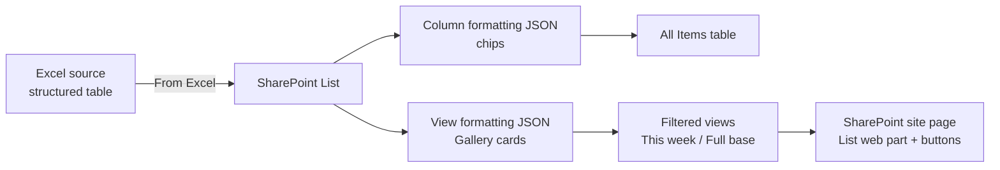

# AI-Assisted Knowledge Management

Claude Code · Prompt Engineering · JSON · SharePoint

Custom visual layer for a SharePoint List used as a security knowledge base: status chips, Gallery cards and filtered views, with the formatting JSON generated and refined through iterative prompting with Claude Code.

---

## 🎯 Problem

Critical security information was hard to browse in the default enterprise interfaces. Analysts had to open long rows in a table to find out whether an alert was already validated, until when, and what to do with it.

## 🛠️ What I built

- **Status chips** on key columns (validity, review, technology, category, MITRE ATT&CK tactic), calculated from the current date.
- **Gallery cards** that show the essentials at a glance: title, context, tactic, validity and the recommendation to apply.
- **Filtered views** ("This week", "Full base") so the list shows what is still valid.
- **JSON generated and refined with Claude Code**, documented in [`docs/prompting-process.md`](docs/prompting-process.md).

## ✅ Outcome

A faster way to find and understand validated context, built with AI assistance instead of weeks of manual coding. The visual layer is reusable: the same JSON works on any list that follows the column structure in the guide.

---

## Architecture



| Layer | Tool | Purpose |
|---|---|---|
| Data | Excel → SharePoint List | Structured records, one row per validated context |
| Presentation (columns) | Column formatting JSON | Colored chips driven by values and date |
| Presentation (cards) | View formatting JSON | Gallery cards with title, tactic and recommendation |
| Navigation | Views and site page | Filtered views and entry point for analysts |
| Authoring | Claude Code | Generation and iteration of the JSON |

## Repository structure

```
ai-assisted-knowledge-management/
├── README.md
├── json/                       Formatting templates (ready to paste)
│   ├── chip-vigencia.json      Validity chip (Vigente / Por vencer / Vencida / Sin vigencia)
│   ├── chip-revision.json      Review chip (OK / Renovar)
│   ├── chip-tecnologia.json    Technology chip with color dot
│   ├── chip-categoria.json     Category chip with icon
│   ├── chip-tactica.json       MITRE ATT&CK tactic chip
│   ├── tarjetas-galeria.json   Full Gallery card
│   └── tarjetas-galeria-basica.json  Minimal fallback card
├── docs/
│   ├── GUIA_SharePoint.md      Step-by-step setup
│   └── prompting-process.md    How the JSON was built with Claude Code
├── examples/
│   ├── sample-data.csv         Fictitious records with the same structure
│   └── card-preview.html       Static preview of the card design
└── CHANGELOG.md
```

## Quick start

1. Create a list from an Excel table with the columns in [`examples/sample-data.csv`](examples/sample-data.csv).
2. Apply the chip JSON to each column (see the guide).
3. Create a Gallery view and paste `json/tarjetas-galeria.json`.
4. Filter the view with `Vigencia >= [Today]`.

Full instructions: [`docs/GUIA_SharePoint.md`](docs/GUIA_SharePoint.md).

## Design decisions

- **Dates calculated in the formatting, not in columns.** SharePoint calculated columns do not refresh with the current date, so the chips compute the status each time the list loads.
- **A fallback card.** The full card depends on more expressions; the basic one keeps the layout usable if a column is missing.
- **Internal names matter.** SharePoint names columns in import order (`field_1`, `field_2`, ...), so the JSON references those names. The guide explains how to find them.
- **Sample data only.** The repository contains no operational data, only structure and templates.

## Limitations

- Formatting JSON is not tested across all SharePoint tenants; behavior can vary with admin restrictions.
- Gallery layout is limited by SharePoint: no custom fonts, and the command bar and view selector are fixed.
- Chips depend on exact text values in Choice columns. Typos break the color.

## Roadmap

- Power Automate flow for a weekly summary and expiry reminders (in progress in the source project).
- Power BI dashboard for trends by technology and tactic.

## License

[Pending: choose a license before publishing.]
